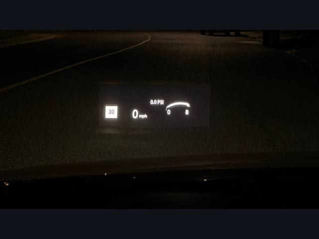

# NBT Evo ID6 apps

**Komendy dla naszego portu Evo Y:** [KOMENDY.md](KOMENDY.md) — instalacja, przywracanie poprzedniej wersji, build, testy i diagnostyka. Ta ściąga opisuje bieżące skrypty forka; poniższy opis zawiera również funkcje pakietów upstream.

For manual testing on the local NBTevo_Y24073J port, use [Install-Evo.cmd](Install-Evo.cmd) and [Uninstall-Evo.cmd](Uninstall-Evo.cmd). See the [manual testing guide (Polish)](TESTY-W-AUCIE.md). These scripts do not restart iDrive automatically.

Connect your parked car to a computer over wired ENET. Open an AI agent with terminal access on that computer and give it this repository and [AgentReadMe.md](AgentReadMe.md). The agent identifies your head unit, checks compatibility, and installs your chosen apps under **My Vehicle**.

If your head unit needs temporary SSH access, use [Bavarian SSH Client](https://ssh.bavarian-aa.uk/) when your agent asks. Check that the client supports your exact head unit and firmware.

## iDrive 6 compatibility

The porting workflow can be used to evaluate any iDrive 6 version. Prebuilt packages target the verified reference firmware and framework combination documented in the AgentReadMe. Other versions need a compatibility check and may need a car-specific build. HUD Gauges also requires a compatible factory windshield HUD.

## Tell your agent what to install

Choose **MHD+ Suite** or **Bootmod3 Suite**. Also say **yes or no to the xDelete-style xDrive menu** and **yes or no to HUD Gauges**. Bootmod3 and xDrive Control are beta packages. xDrive Control is still being tested, with no guarantee of compatibility or operation.

> My car is parked, iDrive is awake, and this computer is connected over wired ENET. Follow the AgentReadMe to install BoostDeck, ShiftDeck, and Engine Fault Codes. My tuning menu choice is **[MHD+ Suite / Bootmod3 Suite]**. My xDrive Control choice is **[yes / no]**. My HUD Gauges choice is **[yes / no]**. Verify firmware, framework hashes, and display resolution before uploading. Ask me when temporary SSH or a parked restart is needed.

[Quick Start](Quick%20Start.md) · [Change notes](CHANGELOG.md) · [Native source](source/)

## Features

- **BoostDeck** has faster gauge updates and a new bar layout. It displays boost, AFR, ignition timing, intake air temperature, transmission temperature, rail pressure, oil pressure, coolant temperature, and Active Ethanol. Press **OPTIONS** for gauge colors, including Multicolor, and to switch between PSI and Fahrenheit or bar and Celsius.
- **ShiftDeck** displays live speed, an RPM bar, and shift lights with a selectable RPM threshold. Press **OPTIONS** to switch between mph and km/h. This update includes performance improvements.
- **MHD+ Suite** offers four map slots, exhaust flap control, and Max Cooling on compatible MHD+ tunes.
- **Bootmod3 Suite** is a new beta control menu for compatible CustomROM tunes. It offers four map slots, exhaust flap control, Active Sound, and burble presets.
- **xDrive Control** is an xDelete-style beta menu for temporarily selecting rear-wheel drive on supported DSC versions. It is still being tested, with no guarantee of compatibility or operation. **The engine must be off before switching from AWD to RWD or from RWD to AWD.**
- **Engine Fault Codes** reads engine/DME fault codes and shows descriptions when available. It can read codes even when the DME refuses to clear them.
- **HUD Gauges** projects a live curved tachometer and numeric boost in PSI onto the factory windshield HUD. The tach spans 0–8,000 RPM, with a thicker redline zone starting at 6,700 RPM. Enable **My Vehicle → HUD Gauges → Show HUD gauges** to keep the display on after leaving the menu and restore it at the next boot. Uncheck it to clear the display. The overlay yields when it detects factory navigation guidance. [HUD Gauges package](packages/hud-gauges.zip)

## Photo Showcase

<table>
  <tr>
    <td> BoostDeck</td>
    <td> ShiftDeck</td>
  </tr>
  <tr>
    <td> MHD+ Suite</td>
    <td> Exhaust flap</td>
  </tr>
  <tr>
    <td> Max Cooling</td>
  </tr>
</table>

### HUD Gauges

These photos show earlier versions of the windshield overlay.

<table>
  <tr>
    <td></td>
    <td></td>
  </tr>
</table>
