# NBT Evo ID6 apps

**Komendy dla naszego portu Evo Y:** [KOMENDY.md](KOMENDY.md) — instalacja, przywracanie poprzedniej wersji, build, testy i diagnostyka. Ta ściąga opisuje bieżące skrypty forka; poniższy opis zawiera również funkcje pakietów upstream.

For manual testing on the local NBTevo_Y24073J port, use [Install-Evo.cmd](Install-Evo.cmd) and [Uninstall-Evo.cmd](Uninstall-Evo.cmd). See the [manual testing guide (Polish)](TESTY-W-AUCIE.md). These scripts do not restart iDrive automatically.

Connect your parked car to a computer over wired ENET. Open an AI agent with terminal access on that computer and give it this repository and [AgentReadMe.md](AgentReadMe.md). The agent identifies your head unit, checks compatibility, and installs your chosen apps under **My Vehicle**.

## Unsupported firmware? Run the Trio Compatibility Collector

If your version is unsupported, enable temporary SSH with Bavarian SSH Client first. Run the [Trio Compatibility Collector](source/tools/trio-collector/Quick%20Start.md) and email the ZIP it creates to [nordicbmwdealer@gmail.com](mailto:nordicbmwdealer@gmail.com) so we can get a fix to you quickly.

## Desktop installer (beta)

[Download the macOS or Windows installer](https://github.com/inotbarnacle/ID6_apps_prerelease/releases/tag/installer-v0.7.4). Follow the [setup, install, and uninstall guide](Installer.md). Temporary SSH must be enabled before opening the installer.

[NBTApps](https://github.com/tom-pryor/nbtapps) also distributes these apps through its [community catalogue](https://github.com/tom-pryor/nbtapps-packages). The v0.7.4 release includes the package handoff for the catalogue maintainer. Check your firmware against the [compatibility matrix](source/docs/COMPATIBILITY.md) before installing. HUD Gauges and xDrive Control are experimental.

## iDrive 6 compatibility

The porting workflow can be used to evaluate any iDrive 6 version. Prebuilt packages target the verified reference firmware and framework combination documented in the AgentReadMe. Other versions need a compatibility check and may need a car-specific build. HUD Gauges also requires a compatible factory windshield HUD.

## Tell your agent what to install

Choose **MHD+ Suite** or **Bootmod3 Suite**. [Download the dashboard package](packages/dashboard.zip). Also say whether to install **xDrive Control** and **HUD Gauges**. Both are experimental. Bootmod3 Suite is in beta.

> My car is parked, iDrive is awake, and this computer is connected over wired ENET. Follow the AgentReadMe to install BoostDeck, ShiftDeck, and Engine Fault Codes. My tuning menu choice is **[MHD+ Suite / Bootmod3 Suite]**. My xDrive Control (experimental) choice is **[yes / no]**. My HUD Gauges choice is **[yes / no]**. Verify firmware, framework hashes, and display resolution before uploading. Ask me when temporary SSH or a parked restart is needed.

[Quick Start](Quick%20Start.md) · [Uninstall](AgentReadMe.md#uninstall) · [Change notes](CHANGELOG.md) · [Native source](source/)

## Features

- **BoostDeck** keeps the original eight main gauges and the right-hand Active Ethanol position. Each position is configurable. Open **OPTIONS → Configure gauges**, select **Gauge 1** through **Gauge 9**, and choose a reading such as oil temperature, voltage, RPM, boost, or fuel rail pressure. Open **OPTIONS → Engine profile** for the diesel OBD profile. Gasoline and diesel keep separate gauge layouts. Layouts, the selected engine profile, colors, and units are saved for the next iDrive start.
- **LaunchDeck** times 0–60 and 60–130 mph or 0–100 and 100–200 km/h. The menu shows a green **Ready** check, **Measuring** during a run, and the last three results for each mode. Display resolution is 0.01 s, with measurement precision limited by OBD speed sampling. [LaunchDeck package](packages/launchdeck.zip)
- **ShiftDeck** displays live speed, an RPM bar, and shift lights with a selectable RPM threshold. Press **OPTIONS** to switch between mph and km/h. This update includes performance improvements.
- **MHD+ Suite** offers four map slots and puts **Exhaust Flap** and **Max Cooling** under **Options**. The main screen shows the last map and Max Cooling settings accepted by the DME during the current app session.
- **Bootmod3 Suite** is a new beta control menu for compatible CustomROM tunes. It offers four map slots, exhaust flap control, Active Sound, and burble presets.
- **xDrive Control (experimental)** temporarily selects rear-wheel drive on supported DSC versions. Mode changes require confirmed Park and zero speed. The F-series DSC_25 (0F1860) with LMV 0F1480 requires the engine running. The supported G-series DSCs require the engine off. See the [compatibility notes](source/docs/COMPATIBILITY.md#xdrive-control-experimental).
- **Engine Fault Codes** reads engine/DME fault codes and shows descriptions when available. It can read codes even when the DME refuses to clear them.
- **Road Jet**. A simple game that makes a jet move based on throttle input and steering angle. [Road Jet package](packages/road-jet.zip)
- **BEAMer** offers Front, Rear, Both, and Insane lighting patterns in Park at zero speed. Tested on an F3x car. Other Fxx cars may work if they have the supported lighting module. Gxx has not been tested. [BEAMer package](packages/beamer.zip)
- **HUD Gauges** projects a live curved tachometer and numeric boost in PSI onto the factory windshield HUD. The tach spans 0–8,000 RPM, with a thicker redline zone starting at 6,700 RPM. Enable **My Vehicle → HUD Gauges → Show HUD gauges** to keep the display on after leaving the menu and restore it at the next boot. Uncheck it to clear the display. The overlay yields when it detects factory navigation guidance. [HUD Gauges package](packages/hud-gauges.zip)

## iDrive menus

### General menus

<table>
  <tr>
    <td>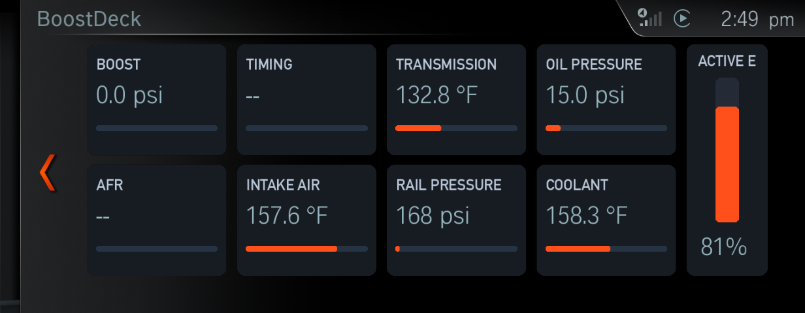 BoostDeck</td>
    <td>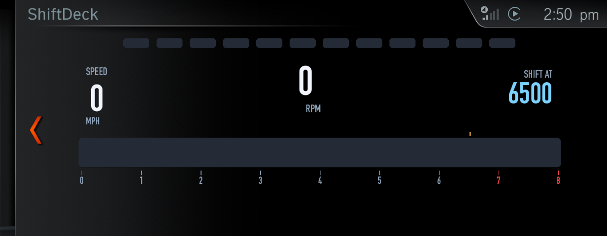 ShiftDeck</td>
  </tr>
  <tr>
    <td>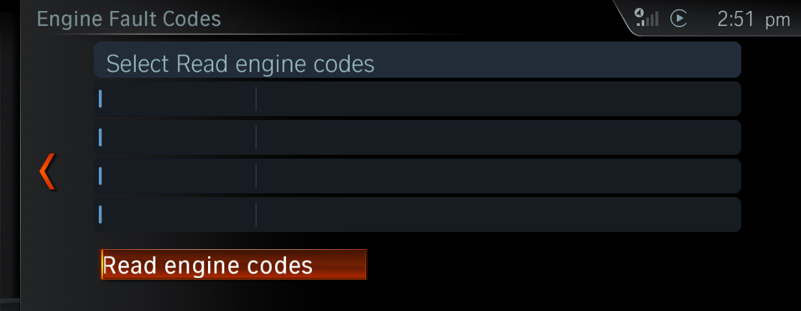 Engine Fault Codes</td>
    <td>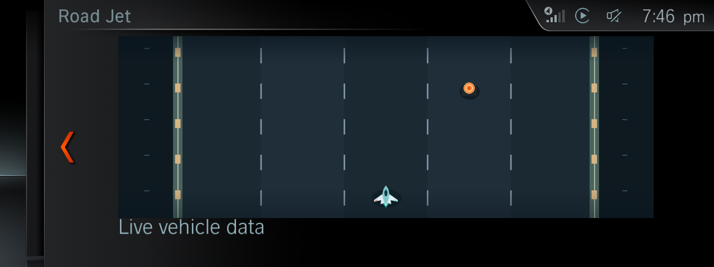 Road Jet</td>
  </tr>
  <tr>
    <td>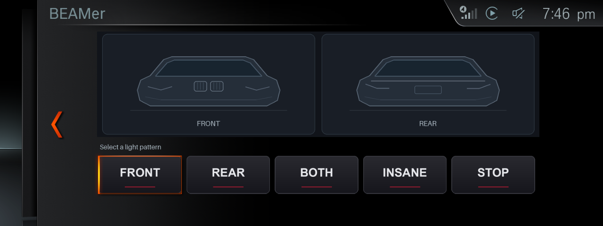 BEAMer</td>
    <td>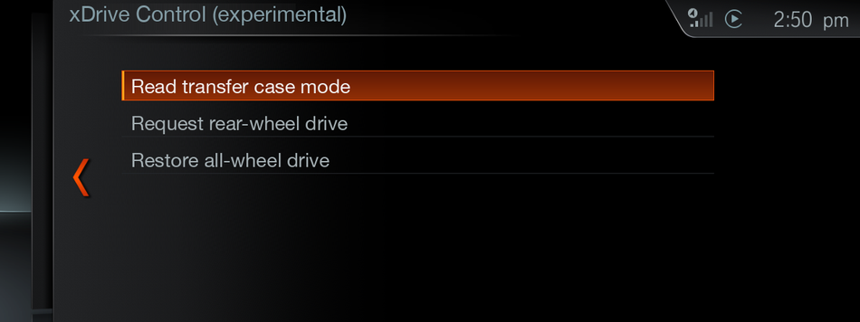 xDrive Control (experimental)</td>
  </tr>
</table>

### MHD specific

<table>
  <tr>
    <td>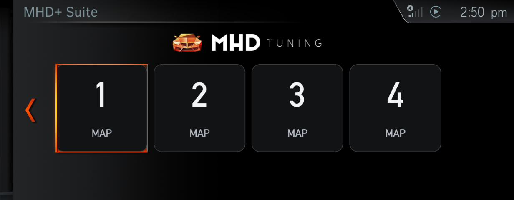 MHD+ Suite</td>
    <td>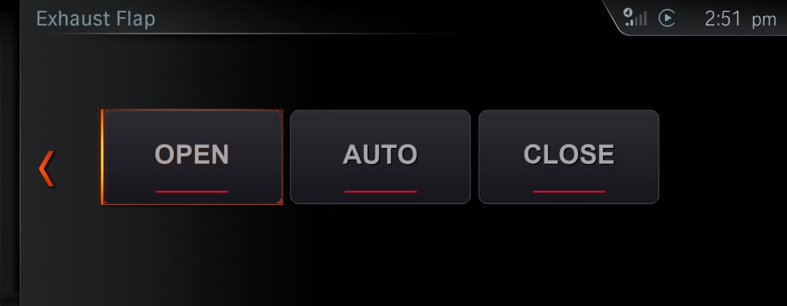 Exhaust Flap</td>
  </tr>
  <tr>
    <td>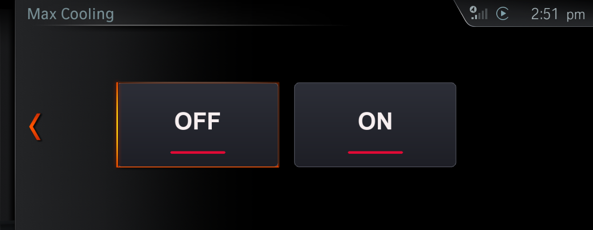 Max Cooling</td>
  </tr>
</table>

### Bootmod3 specific

<table>
  <tr>
    <td>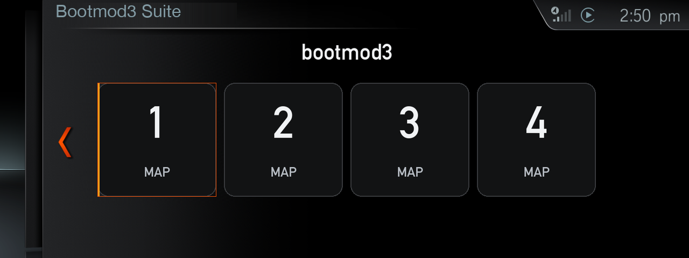 Map Switcher</td>
    <td>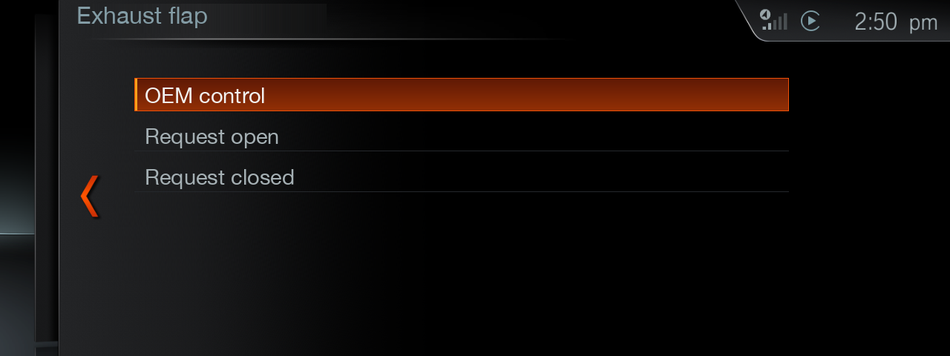 Exhaust Flap</td>
  </tr>
  <tr>
    <td>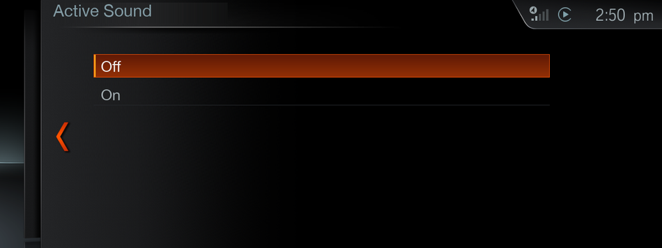 Active Sound</td>
    <td>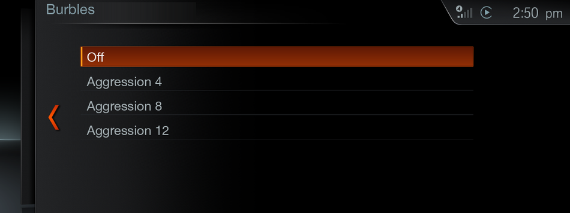 Burbles</td>
  </tr>
</table>

### HUD Gauges

**Only tested on F3X vehicles**

<table>
  <tr>
    <td></td>
    <td>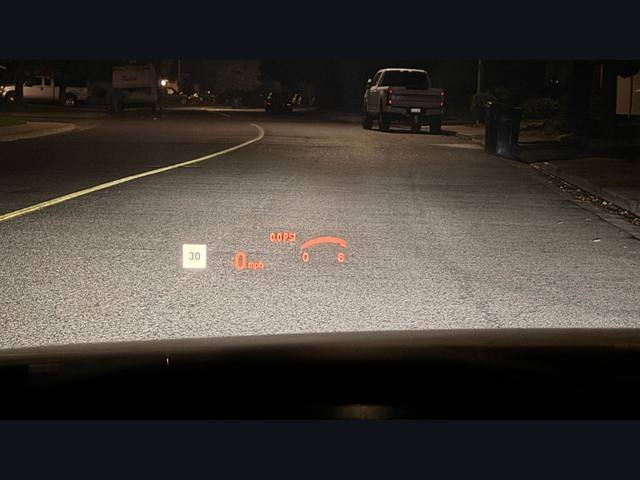</td>
  </tr>
</table>
